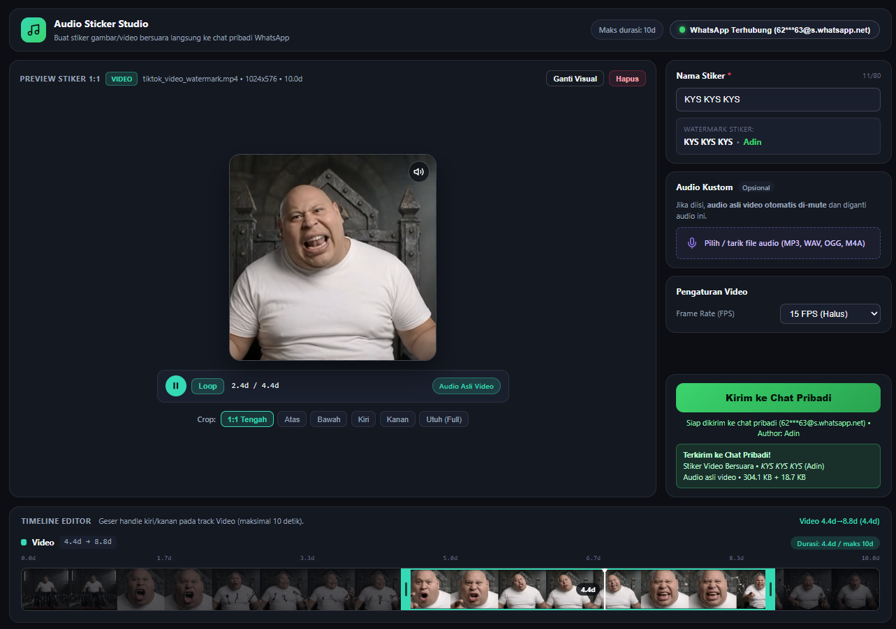

<div align="center">
  
  <h1>Stickerwave</h1>
  <p><strong>Local desktop studio for creating &amp; sending WhatsApp Native Audio Stickers directly to your personal chat.</strong></p>
</div>

---

<div align="center">
  
</div>

---

## Features

- **Connect-First WhatsApp Login** — On first launch, scan the QR code (or use a Pairing Code) directly inside the app. The editor unlocks automatically once linked, and you can **Logout / Unlink** anytime from the top bar.
- **Single Visual Input** — Choose either **1 image** (`JPG`, `PNG`, `WebP`) or **1 video / GIF** (`MP4`, `MOV`, `WebM`, `GIF`).
- **Interactive 1:1 Crop** — Drag directly inside the square preview frame or pick quick presets (`Center`, `Top`, `Bottom`, `Left`, `Right`, `Full`).
- **CapCut-Style Video Timeline** — Drag start & end handles to pick your exact clip, automatically capped to a safe maximum duration (`10s` by default) so WhatsApp never rejects it.
- **Optional Custom Audio (Override & Sync)** — Add any audio file (`MP3`, `WAV`, `OGG`, `M4A`) to mute the original video audio and replace it. When paired with video, simply drag the **audio start point** — its duration stays locked to match your trimmed video length.
- **Live Synced Preview** — Press **Play** (or `Space`) to preview video and audio in sync before sending.
- **Required Sticker Name & Direct Self-Chat Send** — Enter a sticker name and hit **Send** to deliver a native WhatsApp Audio Sticker straight to your personal *Message Yourself* chat.

---

## Quick Start

### Prerequisites

- [Node.js](https://nodejs.org/) **v20+** (FFmpeg & FFprobe are bundled automatically via `ffmpeg-static` and `ffprobe-static` — no manual install needed).

### Run Locally

```bash
git clone https://github.com/LecyLecy/stickerwave.git
cd stickerwave
npm install
npm start
```

1. Stickerwave starts a local server at **`http://127.0.0.1:3456`** and opens your browser automatically.
2. **First-time setup:** Scan the QR code shown in the app via **WhatsApp → Linked Devices → Link a Device** (or enter your phone number to use a Pairing Code).
3. Once connected, the studio editor opens automatically.
4. Pick an image or video, trim the timeline, optionally add custom audio, enter a **Sticker Name**, and click **Kirim ke Chat Pribadi**.

> **Note on Audio Sticker Playback:** Native WhatsApp Audio Stickers (tapping the speaker icon to hear sound) are supported on **WhatsApp Web** and **WhatsApp Android Beta / latest releases** that have the native audio sticker feature enabled.

---

## Configuration (Optional)

Copy `.env.example` to `.env` if you want to customize defaults:

| Variable | Default | Description |
| :--- | :--- | :--- |
| `PORT` | `3456` | Local web UI port |
| `MAX_DURATION_SECONDS` | `10` | Maximum sticker clip duration in seconds |
| `MAX_INPUT_SIZE_MB` | `20` | Maximum upload file size per media file |
| `STICKER_AUTHOR` | `Adin` | Publisher watermark written into sticker EXIF |
| `STICKER_CROP_MODE` | `center` | Default 1:1 crop mode (`center`, `top`, `bottom`, `left`, `right`, `none`) |

---

## Project Structure

```text
stickerwave/
├── docs/           # App logo and UI preview screenshot for documentation
├── public/         # Frontend desktop UI (Connect QR gate, 1:1 crop stage, CapCut timelines)
├── src/            # Backend server, WhatsApp connection, media pipeline, and Protobuf patch
│   ├── proto/      # Runtime WAProto patch for native StickerMessage.audioMessage (field 26)
│   ├── services/   # FFmpeg media converter, WebP EXIF injector, and WhatsApp sticker sender
│   └── utils/      # Temp file auto-cleanup, job queue, and redacted logger
└── tests/          # Automated tests for Protobuf, FFmpeg conversion, and Desktop Studio API
```

Each folder contains its own `README.md` with a short summary of its files.

---

## Running Tests

```bash
npm test
```

## Privacy & Security

- Your WhatsApp session is stored locally inside `auth/` (git-ignored and never committed).
- Use the **Logout** button in the top bar anytime to unlink WhatsApp and clear the local session.
- All temporary media files are stored in `temp/` and automatically deleted after every job.
